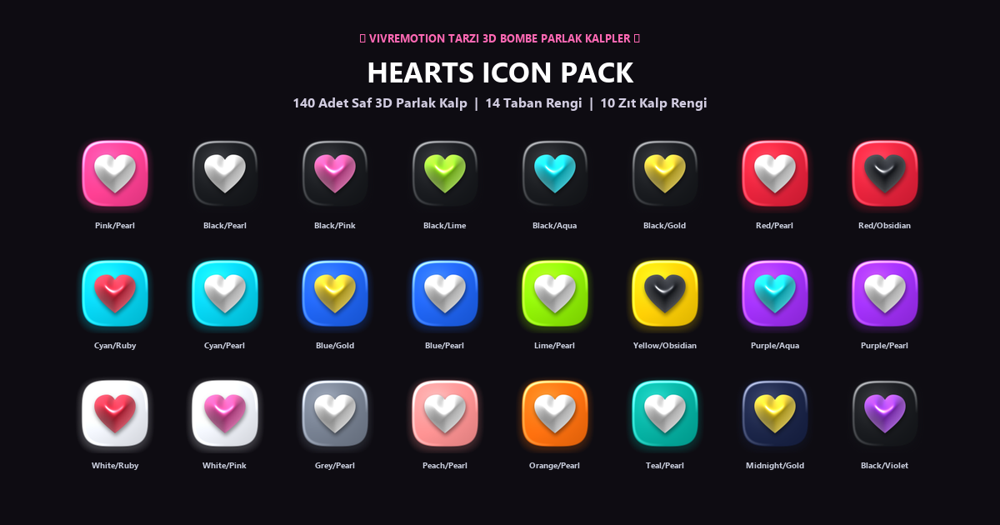

<div align="center">
  
  <h1>Hearts Icon Pack</h1>
  <p><strong>140 aesthetic glossy 3D heart icons in 14 vibrant squircle base colors & 10 pillowy candy heart finishes for Stream Deck & Evoxdeck.</strong></p>

  <p>
    <strong>Language:</strong> <a href="README.md"><strong>EN</strong></a> | <a href="README.tr.md"><strong>TR</strong></a>
    &nbsp;•&nbsp;
    <a href="https://github.com/Hfatih/hearts-icon-pack/releases/latest">Download .evoxpack</a> •
    <a href="https://hfatih.github.io/hearts-icon-pack/">Live Interactive Gallery</a> •
    <a href="#quick-installation">Installation Guide</a>
  </p>

  <p>
    
    
    
    
    
    
  </p>
  <p align="center">
    
  </p>
</div>

---

## 🎨 Visual Showcase

<div align="center">
  
</div>

---

## ✨ Features & Highlights

- **Pure 3D Hearts (No Text / No Logos):** Designed strictly with organic, inflated 3D pillowy hearts resting on glossy glass squircle bases.
- **14 Base Color Themes:**
  `Pink` • `Black` • `Red` • `Cyan` • `Blue` • `Lime` • `Yellow` • `Purple` • `White` • `Grey` • `Peach` • `Orange` • `Teal` • `Midnight`
- **10 3D Heart Finishes:**
  `Pearl White` • `Ruby Red` • `Candy Pink` • `Neon Aqua` • `Cobalt Blue` • `Electric Lime` • `Golden Amber` • `Electric Violet` • `Charcoal Obsidian` • `Chrome Silver`
- **140 High-Contrast & Tone-on-Tone Colorways:** High-energy complementary pairings (e.g., Black & Lime, Red & Pearl, Cyan & Ruby) as well as luxurious stealth monochromes (Black on Black, Pink on Pink).
- **Pixel-Perfect Retina Dimensions:** 128x128 PNG format with pre-rendered ambient occlusion drop shadows, curved glass reflections, and rim lighting.
- **One-Click Evoxdeck & Stream Deck Compatibility:** Native `.evoxpack` package format.

---

## 🌐 Live Interactive Gallery & Stream Deck Simulator

Explore the full 140 heart collection and preview them live on a virtual 15-key Stream Deck simulator:

👉 **[https://hfatih.github.io/hearts-icon-pack/](https://hfatih.github.io/hearts-icon-pack/)**

- **Filter by Base Color:** Instant filtering across 14 color themes.
- **Live Search:** Search by color name (e.g. `pink`, `obsidian`, `pearl`, `aqua`).
- **Interactive Simulator:** Click any heart to place it into the active Stream Deck slot.
- **One-Click Copy:** Click any card to copy the icon's exact filename to your clipboard.

---

## 🚀 Quick Installation

### Method 1: Evoxdeck (.evoxpack — Recommended)
1. Download `Hearts Icon Pack.evoxpack` from the [Releases](https://github.com/Hfatih/hearts-icon-pack/releases/latest) section.
2. Double-click the `.evoxpack` file, or drag and drop it into **Evoxdeck**.
3. All 140 heart icons are automatically categorized and ready to drag onto your keys.

### Method 2: Elgato Stream Deck / Manual PNG
1. Clone or download this repository as a `.zip`.
2. Extract the `icons/` folder to your preferred icons directory.
3. In the Elgato Stream Deck software, select any key, click the `+` icon on the canvas, select **"Set from File"**, and choose your favorite 3D heart icon.

---

## 📂 Repository Structure

```text
hearts-icon-pack/
├── assets/
│   ├── cover.png           # 256x256 high-res package logo
│   └── showcase.png        # 1200x630 visual banner
├── icons/                  # 140 individual 128x128 Retina PNGs
│   ├── heart-001-pink-pearl.png
│   ├── heart-011-black-pearl.png
│   ├── heart-014-black-aqua.png
│   ├── heart-016-black-lime.png
│   └── ...
├── index.html              # GitHub Pages live interactive simulator
├── manifest.json           # Evoxpack package metadata schema
├── LICENSE                 # MIT License
├── README.md               # English Documentation
└── README.tr.md            # Turkish Documentation
```

---

## 📜 License

Distributed under the **MIT License**. Free for personal and commercial stream/desktop customization. See `LICENSE` for details.
